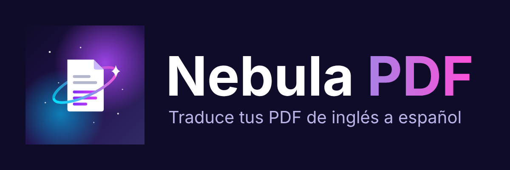

<p align="center">
  
</p>

<p align="center">
  <b>Traduce PDF y libros completos del inglés al español sin perder el diseño original.</b><br>
  App para Android · traducción en el teléfono · pensada para libros de ciberseguridad
</p>

<p align="center">
  <a href="https://github.com/s-Nebula/nebula-pdf/actions/workflows/build.yml"></a>
  
  
</p>

---

## Índice

- [Qué es Nebula PDF](#qué-es-nebula-pdf)
- [Características](#características)
- [Cómo se usa](#cómo-se-usa)
- [Descargar e instalar](#descargar-e-instalar)
- [Cómo funciona por dentro](#cómo-funciona-por-dentro)
- [Términos técnicos que se quedan en inglés](#términos-técnicos-que-se-quedan-en-inglés)
- [Libros largos](#libros-largos)
- [Privacidad](#privacidad)
- [Limitaciones conocidas](#limitaciones-conocidas)
- [Compilar desde el código](#compilar-desde-el-código)
- [Firmar la versión de publicación](#firmar-la-versión-de-publicación)
- [Estructura del proyecto](#estructura-del-proyecto)
- [Desarrollador y contacto](#desarrollador-y-contacto)

## Qué es Nebula PDF

Nebula PDF es una app para Android que toma un PDF en inglés (un artículo, un manual o un libro entero) y genera **el mismo PDF en español**. No crea un documento de texto plano: cada página traducida conserva las imágenes, las tablas, las columnas, los colores, los títulos y la numeración del original. Solo cambia el idioma.

Está pensada sobre todo para **libros de ciberseguridad**, donde muchas palabras deben quedarse en inglés para que sigan funcionando: comandos, nombres de herramientas, payloads, rutas, URLs o fragmentos de código.

La interfaz tiene un estilo retro de escritorio clásico, con ventanas de barra azul, botones con relieve, barra de tareas y menú de inicio.

## Características

| | |
|---|---|
| 📄 **Mismo diseño** | El texto traducido se escribe en la misma posición, con el mismo tamaño, color y tipo de letra aproximado. Imágenes, gráficos y fondos no se tocan. |
| 🔐 **Modo ciberseguridad** | Un glosario editable con más de 200 términos (exploit, payload, reverse shell, Burp Suite, Mimikatz…) que nunca se traducen. |
| 💻 **Código intacto** | Los bloques en letra monoespaciada, las líneas de comandos y el código fuente se copian tal cual. |
| 🧠 **Detección automática** | Se conservan siempre IPs, URLs, correos, rutas de Unix y Windows, claves de registro, CVE/CWE, técnicas MITRE ATT&CK, opciones de comandos (`-sV`, `--dbs`), siglas (XSS, SSRF, TCP), hashes, nombres de archivo y nombres de funciones. |
| 📚 **Libros largos** | La traducción corre en segundo plano con una notificación de progreso. Puedes cerrar la app o apagar la pantalla. |
| 🖼️ **PDF escaneados** | Si una página es solo imagen, la app reconoce el texto (OCR) y escribe la traducción encima. |
| 📴 **Sin servidores** | La traducción se hace en el teléfono con Google ML Kit. Solo se necesita internet una vez para descargar el modelo de idioma (unos 30 MB). |
| 📂 **Abrir desde otras apps** | Puedes usar "Abrir con" o "Compartir" desde el gestor de archivos, el navegador o el correo. |
| 🗂️ **Mis traducciones** | Lista de todos los PDF traducidos, para abrirlos, compartirlos o borrarlos. |

## Cómo se usa

1. Abre **Nebula PDF** y pulsa **Examinar…** para elegir un PDF en inglés.
2. Revisa las opciones:
   - **Conservar términos técnicos en inglés** (activado por defecto).
   - **Reconocer texto en páginas escaneadas (OCR)**.
   - **Editar glosario técnico…** para añadir o quitar palabras que se quedan en inglés.
3. Pulsa **Traducir**. La primera vez se descarga el modelo de idioma.
4. Al terminar, elige **Abrir**, **Guardar como…** o **Compartir**. El archivo se llama igual que el original con ` (ES)` al final.

También puedes abrir el **menú Inicio** de la barra de tareas para ir a *Mis traducciones*, *Glosario técnico* o *Acerca de*.

## Descargar e instalar

Cada cambio en la rama `main` se compila automáticamente con GitHub Actions.

- **Última compilación:** entra en [Actions](https://github.com/s-Nebula/nebula-pdf/actions/workflows/build.yml), abre la ejecución más reciente y descarga el artefacto **NebulaPDF-apk**. Dentro está `NebulaPDF-debug.apk`.
- **Versiones publicadas:** cuando se crea una etiqueta `v1.0.0`, `v1.1.0`, etc., el APK aparece en [Releases](https://github.com/s-Nebula/nebula-pdf/releases).

Para instalarlo, copia el APK al teléfono, ábrelo y permite *instalar apps de origen desconocido* cuando Android lo pida. Requiere **Android 8.0 o superior**.

## Cómo funciona por dentro

```
PDF original
   │
   ├─ 1. Análisis de cada página (PDFBox)
   │     Se leen los glifos con su posición, tamaño, fuente y color.
   │     Se agrupan en renglones y en bloques: párrafos, títulos, celdas,
   │     elementos de lista, pies de foto y bloques de código.
   │     Se detectan columnas, sangrías, texto centrado y justificado.
   │
   ├─ 2. Traducción de cada bloque (ML Kit, en el teléfono)
   │     Antes de traducir se protegen los términos técnicos con marcadores
   │     {{0}}, {{1}}… que el traductor no toca, y luego se restauran.
   │     El código y los comandos no pasan por el traductor.
   │
   ├─ 3. Reescritura de la página
   │     Se eliminan del contenido de la página las instrucciones que pintan
   │     texto, sin tocar imágenes ni gráficos. La traducción se escribe en el
   │     mismo lugar; si el español es más largo, el texto se reparte en el
   │     espacio libre y, si hace falta, se reduce un poco la letra.
   │
   └─ 4. Se guarda el PDF nuevo: mismas páginas, mismo orden, en español.
```

En páginas escaneadas (sin texto), la página se convierte en imagen, se reconoce el texto con OCR, se tapa cada bloque con un recuadro blanco y se escribe la traducción encima.

## Términos técnicos que se quedan en inglés

El glosario por defecto incluye, entre otros:

- **Ataques y técnicas:** exploit, payload, shellcode, reverse shell, bind shell, web shell, backdoor, rootkit, phishing, spoofing, sniffing, buffer overflow, use-after-free, SQL injection, cross-site scripting, server-side request forgery, path traversal, pass-the-hash, kerberoasting, golden ticket, pivoting, fuzzing…
- **Conceptos:** red team, blue team, pentest, bug bounty, zero-day, sandbox, honeypot, token, hash, salt, cookie, endpoint, framework, kernel, firmware…
- **Herramientas:** Metasploit, Meterpreter, msfvenom, Burp Suite, Nmap, Wireshark, Hashcat, John the Ripper, Hydra, Mimikatz, BloodHound, Impacket, CrackMapExec, sqlmap, Gobuster, ffuf, Netcat, Ghidra, IDA Pro, Volatility, Aircrack-ng, Kali Linux…

Puedes editar la lista desde **Inicio → Glosario técnico**. Escribe un término por línea; las líneas que empiezan con `#` se ignoran. Además de la lista, siempre se conservan los patrones técnicos descritos en [Características](#características).

## Libros largos

- La traducción se ejecuta en un **servicio en primer plano** con notificación de progreso y botón **Cancelar**.
- La app mantiene la CPU activa mientras traduce, así que no se detiene al apagar la pantalla.
- El PDF se procesa **página por página** y usa archivos temporales en lugar de memoria, para que libros de cientos de páginas no agoten la RAM.
- Los textos repetidos (encabezados, pies de página) se traducen una sola vez.
- Tiempo orientativo: entre 1 y 3 segundos por página en un teléfono de gama media. Un libro de 300 páginas puede tardar de 5 a 15 minutos.

## Privacidad

- Tus documentos **no salen del teléfono**. La traducción y el OCR se hacen en el dispositivo.
- La app solo usa internet para descargar el modelo de idioma inglés-español la primera vez.
- Los PDF traducidos se guardan en el almacenamiento privado de la app hasta que los borres o los guardes en otra carpeta.

## Limitaciones conocidas

- La traducción automática en el dispositivo es buena pero no perfecta. Para textos legales o publicaciones, revisa el resultado.
- El texto traducido usa las fuentes estándar del PDF (Helvetica, Times y Courier) en vez de la fuente original incrustada, así que el aspecto es parecido pero no idéntico.
- Si una página tiene muy poco espacio libre, la letra traducida puede quedar algo más pequeña que la original.
- Los subrayados de los enlaces se quedan en su posición original.
- Las páginas giradas se dejan sin traducir, y el texto girado se tapa y se reescribe en horizontal.
- PDF protegidos con contraseña de apertura no se pueden abrir.

## Compilar desde el código

Requisitos: **Android Studio** (Ladybug o superior) o el **JDK 17** con el SDK de Android.

```bash
git clone https://github.com/s-Nebula/nebula-pdf.git
cd nebula-pdf
./gradlew assembleDebug          # APK en app/build/outputs/apk/debug/
./gradlew testDebugUnitTest      # pruebas del motor
```

Tecnologías:

| Parte | Tecnología |
|---|---|
| Lenguaje | Kotlin 2.0 |
| Interfaz | Jetpack Compose (componentes de estilo clásico dibujados a mano) |
| Lectura y escritura de PDF | [PdfBox-Android](https://github.com/TomRoush/PdfBox-Android) 2.0.27 |
| Traducción | [ML Kit Translation](https://developers.google.com/ml-kit/language/translation) (en el dispositivo) |
| OCR | [ML Kit Text Recognition](https://developers.google.com/ml-kit/vision/text-recognition/v2) |
| Segundo plano | Servicio en primer plano + notificaciones |
| Compilación | Gradle 8.10, AGP 8.7, GitHub Actions |

## Firmar la versión de publicación

Para generar un APK de publicación firmado (por ejemplo, para Google Play):

1. Crea un almacén de claves si no tienes uno:
   ```bash
   keytool -genkey -v -keystore nebula.jks -keyalg RSA -keysize 2048 -validity 10000 -alias nebula
   ```
2. **En tu computador**, crea `keystore.properties` en la raíz del proyecto (está en `.gitignore`, no se sube):
   ```properties
   storeFile=nebula.jks
   storePassword=TU_CONTRASEÑA
   keyAlias=nebula
   keyPassword=TU_CONTRASEÑA
   ```
   y ejecuta `./gradlew assembleRelease`.
3. **En GitHub Actions**, añade estos secretos en *Settings → Secrets and variables → Actions*:
   `KEYSTORE_BASE64` (el resultado de `base64 -w0 nebula.jks`), `KEYSTORE_PASSWORD`, `KEY_ALIAS` y `KEY_PASSWORD`. A partir de ahí cada compilación incluye `NebulaPDF.apk` firmado.

Nunca subas el archivo `.jks` ni las contraseñas al repositorio.

## Estructura del proyecto

```
app/src/main/java/org/vestaopensource/nebulapdf/
├── core/                      Motor de traducción (sin dependencias de Android)
│   ├── BlockExtractor.kt      Lee glifos y los agrupa en renglones y bloques
│   ├── TermProtector.kt       Glosario, patrones técnicos y detección de código
│   ├── PageRewriter.kt        Quita el texto original y escribe la traducción
│   └── BookTranslator.kt      Recorre el libro página por página
├── engine/
│   ├── MlKitTranslator.kt     Traductor inglés → español en el dispositivo
│   └── MlKitOcr.kt            OCR para páginas escaneadas
├── ui/Xp.kt                   Ventanas, botones, barra de tareas y menú de inicio
├── MainActivity.kt            Pantallas: Traductor, Mis traducciones, Glosario, Acerca de
├── TranslationService.kt      Servicio en segundo plano con notificación
├── TranslationState.kt        Estado compartido entre servicio e interfaz
├── Settings.kt                Preferencias y glosario del usuario
└── NebulaApp.kt               Inicialización
logo/                          Logo en SVG y PNG
```

## Desarrollador y contacto

**Nebula** · **FORBIDDEN S.A.S.** (NIT 901653270-2) · Santa Marta, Colombia
Parte del proyecto **VESTA SECURITY**.

- 📧 Correo: [nebulagnu@proton.me](mailto:nebulagnu@proton.me)
- 💬 WhatsApp: [+57 324 616 7956](https://wa.me/573246167956)
- 🌐 Web: [vestasecurity.date](https://vestasecurity.date)
- 🐙 GitHub: [@s-Nebula](https://github.com/s-Nebula)

© 2026 FORBIDDEN S.A.S. Todos los derechos reservados.
